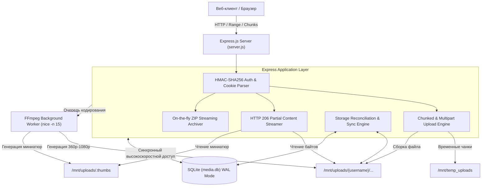

# Provideo Media Holding — Self-Hosted Media Cloud & Video Streaming Platform

Полнофункциональное высокопроизводительное веб-приложение для безопасного хранения, каталогизации, транскодирования, адаптивного стриминга и совместного использования видео и фотографий высокого разрешения.

Разработано для сценариев медиа-продакшна, видео-архивов и корпоративных хранилищ с поддержкой тяжелых файлов, потоковой генерации ZIP-архивов на лету и докачки после обрыва связи.

---

## 🌟 Ключевые возможности

### 1. Загрузка и управление медиафайлами
- **Чанковая загрузка (Chunked Upload)**: Загрузка файлов неограниченного размера блоками по 10 МБ с низким потреблением оперативной памяти сервера.
- **Возобновляемая загрузка (Resumable Uploads)**: Автоматическое продолжение прерванной загрузки с сохраненного смещения (`offset`) при сетевых сбоях; очередь сохраняется в `localStorage`.
- **Drag & Drop целых директорий**: Загрузка вложенных папок с сохранением оригинальной иерархической структуры благодаря атрибутам `webkitdirectory` и передаче `relative_paths`.
- **Поддержка широкого спектра форматов**:
  - **Видео**: MP4, MKV, WebM, AVI, MOV, M4V, WMV, FLV, 3GP, TS, M2TS, VOB, OGV, MPG и др.
  - **Фото и RAW**: JPEG, PNG, GIF, WebP, SVG, BMP, ICO, TIFF, HEIC, HEIF, AVIF, CR2, CR3, NEF, ARW, DNG.

### 2. Стриминг и воспроизведение
- **HTTP Range Requests (RFC 7233)**: Потоковая отдача медиа с поддержкой `206 Partial Content` и заголовка `Accept-Ranges: bytes`, обеспечивающая мгновенную перемотку видео без полной предзагрузки.
- **Адаптивное мультибитрейтное воспроизведение**: Фоновое транскодирование видео в разрешения `1080p`, `720p`, `480p`, `360p` с динамическим переключением качества в плеере на лету.
- **Встроенный медиаплеер и галерея**:
  - Кастомный HTML5 плеер с запоминанием контекста навигации и позиции скролла.
  - Просмотр изображений с предварительной демонстрацией сгенерированного превью и фоновой догрузкой оригинала сверхвысокого разрешения.

### 3. Обработка медиа на базе FFmpeg
- **Фоновая очередь транскодирования**: Очередь кодирования с пониженным приоритетом CPU (`nice -n 15`) для предотвращения деградации производительности сервера во время стриминга.
- **Генерация превью (Thumbnails)**: Мгновенное создание адаптивных миниатюр для видео и фото с фильтром масштабирования `scale='min(600,iw)':-2`.
- **Дедупликация задач (In-Flight Caching)**: Исключение повторного кодирования одних и тех же кадров при параллельных клиентских запросах.
- **Пакетный CLI-генератор**: Утилита `generate-thumbnails.js` с настраиваемой параллельностью (`--concurrency=N`) и флагом принудительной перегенерации (`--force`).

### 4. Иерархия, синхронизация и целостность данных
- **Иерархическая файловая система**: Неограниченная вложенность папок с навигацией по "хлебным крошкам" (Breadcrumbs) и подсчетом агрегированной статистики (число файлов и суммарный вес поддерева через рекурсивные CTE-запросы).
- **Self-Healing Storage Engine (Сверка диска и БД)**: Модуль автоматической сверки (`reconcileStorageAndDb`) сопоставляет физические файлы на диске (`uploads/<username>/...`) со структурой в SQLite, создавая недостающие записи, удаляя битые ссылки и сглаживая дубликаты папок.
- **Потоковая архивация (Streaming ZIP on-the-fly)**: Скачивание всей папки с сохранением вложенных директорий в виде единого ZIP-архива без создания временных файлов на диске (прямая передача через `Stream.pipe(res)`).

### 5. Безопасность и шеринг
- **Публичные ссылки**: Генерация компактных криптостойких идентификаторов (`nanoid`) для видео и целых папок.
- **Настраиваемый срок жизни (TTL / Expiration)**: Автоматическая экспирация публичных ссылок (по умолчанию 2 месяца с возможностью продления или мгновенного отзыва).
- **Защита от Directory Traversal**: Валидация доступа к файлам внутри расшаренных папок через рекурсивные SQL-проверки принадлежности дереву.
- **Аутентификация без внешних сессионных хранилищ**: HMAC-SHA256 подписанные токены (`username.expires.hmac`) со сверкой через `crypto.timingSafeEqual` против атак по времени (Timing Attacks). Поддержка `HttpOnly`, `SameSite=Lax/None`, `Secure` cookies и Bearer-заголовков.
- **Управление пользователями**: Ролевая модель (`admin` и обычные пользователи), хэширование паролей с помощью `bcrypt` (10 раундов соли).

### 6. Интерфейс и Developer Experience
- **Быстрый Vanilla UI**: Нулевой оверхед (без тяжелых SPA-фреймворков), нативный CSS с переменными, темная тема (`#030014`), адаптивность под мобильные экраны и учет Safe Area мобильных браузеров.
- **Умный поиск и сортировка**: Регистронезависимый поиск по нескольким словам с поддержкой UTF-8 (`contains_utf8`), а также натуральная сортировка названий (Natural Sort order: `1, 2, 10` вместо `1, 10, 2`).
- **Встроенная консоль отладки**: Интегрированная панель мониторинга сетевых запросов, статусов ответов и ошибок для диагностики прямо в браузере.

---

## 🛠 Технологический стек

| Слой | Технологии |
|---|---|
| **Runtime & Backend** | [Node.js](https://nodejs.org/) (ES6+), [Express.js 4](https://expressjs.com/) |
| **База данных** | [SQLite 3](https://sqlite.org/) via [`better-sqlite3`](https://github.com/WiseLibs/better-sqlite3) (WAL Mode, Foreign Keys, Custom UTF-8 C Functions, Recursive CTEs) |
| **Медиа-движок** | [FFmpeg](https://ffmpeg.org/), [FFprobe](https://ffmpeg.org/ffprobe.html) (транскодирование, scale-фильтры, снятие ключевых кадров) |
| **Загрузка и потоки** | [`multer`](https://github.com/expressjs/multer) (обработка мультипартов и чанков), Node.js Streams, [`archiver`](https://github.com/archiverjs/node-archiver) |
| **Безопасность** | `crypto` (HMAC-SHA256, Timing Safe Equal), [`bcrypt`](https://github.com/kelektiv/node.bcrypt.js), `cookie-parser` |
| **Frontend** | Нативный HTML5, CSS3 (Custom Properties, Grid/Flexbox), Vanilla JS (Fetch API, Web Streams, History API, Viewport API) |

---

## 📐 Архитектура системы



---

## 🗄 Структура базы данных

### 1. `users` — Пользователи
```sql
CREATE TABLE users (
  id INTEGER PRIMARY KEY AUTOINCREMENT,
  username TEXT NOT NULL UNIQUE,
  password_hash TEXT NOT NULL,
  created_at DATETIME DEFAULT CURRENT_TIMESTAMP
);
```

### 2. `folders` — Иерархия папок
```sql
CREATE TABLE folders (
  id INTEGER PRIMARY KEY AUTOINCREMENT,
  name TEXT NOT NULL,
  parent_id INTEGER DEFAULT NULL,
  uploader_username TEXT NOT NULL,
  share_id TEXT UNIQUE,
  share_expires_at DATETIME,
  is_shared INTEGER DEFAULT 0,
  created_at DATETIME DEFAULT CURRENT_TIMESTAMP,
  FOREIGN KEY(parent_id) REFERENCES folders(id) ON DELETE CASCADE
);
```

### 3. `videos` — Медиафайлы (видео и фото)
```sql
CREATE TABLE videos (
  id INTEGER PRIMARY KEY AUTOINCREMENT,
  filename TEXT NOT NULL,
  stored_name TEXT NOT NULL UNIQUE,
  size INTEGER NOT NULL,
  mime_type TEXT NOT NULL DEFAULT 'video/mp4',
  share_id TEXT UNIQUE,
  share_expires_at DATETIME,
  is_shared INTEGER DEFAULT 0,
  uploader_username TEXT,
  folder_id INTEGER DEFAULT NULL REFERENCES folders(id) ON DELETE CASCADE,
  created_at DATETIME DEFAULT CURRENT_TIMESTAMP
);
```

### 4. `settings` — Конфигурация системы
```sql
CREATE TABLE settings (
  id INTEGER PRIMARY KEY AUTOINCREMENT,
  key TEXT NOT NULL UNIQUE,
  value TEXT NOT NULL
);
```

---

## 🔌 Основные API эндпоинты

### Аутентификация и пользователи
- `POST /api/login` — Аутентификация, установка защищенной cookie `auth_token`
- `POST /api/logout` — Завершение сессии и очистка cookies
- `GET /api/me` — Информация о текущем пользователе и правах
- `GET /api/users` — Список пользователей (только для `admin`)
- `POST /api/register` — Регистрация нового пользователя (только для `admin`)
- `DELETE /api/users/:id` — Удаление пользователя (только для `admin`)

### Файлы и папки
- `GET /api/folders?parent_id=&search=&sort_by=` — Список папок с подсчетом вложенных файлов и размера
- `POST /api/folders` — Создание папки
- `PATCH /api/folders/:id` — Переименование папки (с каскадным перемещением на диске)
- `DELETE /api/folders/:id` — Удаление папки и её содержимого
- `GET /api/folders/:id/zip` — Потоковое скачивание папки в виде ZIP
- `GET /api/folders/:id/tree` — Полное дерево файлов внутри папки
- `GET /api/videos?folder_id=&search=&sort_by=` — Список файлов с пагинацией и поиском
- `PATCH /api/videos/:id` — Переименование файла
- `DELETE /api/videos/:id` — Удаление файла и всех его транскодированных версий

### Загрузка данных
- `POST /api/upload` — Пакетная загрузка файлов
- `GET /api/upload/status?uploadId=` — Проверка смещения для возобновляемой загрузки
- `POST /api/upload/chunk` — Загрузка отдельного чанка файла

### Стриминг и медиа
- `GET /api/stream/:id?q=original|1080p|720p|480p|360p` — Потоковый стриминг с поддержкой Range-запросов
- `GET /api/thumbnail/:id` — Получение оптимизированного изображения предпросмотра
- `GET /api/videos/:id/qualities` — Список доступных вариантов качества видео

### Публичный доступ (Шеринг)
- `POST /api/videos/:id/share` / `POST /api/folders/:id/share` — Создание или отключение публичного доступа
- `POST /api/videos/:id/share/regenerate` — Перегенерация ключа доступа
- `PATCH /api/videos/:id/share/expire` — Изменение даты окончания действия ссылки
- `GET /s/:shareId` — Публичная веб-страница просмотра видео
- `GET /s/f/:shareId` — Публичный веб-интерфейс расшаренной папки
- `GET /api/share/:shareId/stream` — Публичный стриминг файла
- `GET /api/share/folder/:shareId/zip` — Публичное скачивание всей папки в ZIP-архиве

---

## ⚙️ Переменные окружения

| Переменная | По умолчанию | Описание |
|---|---|---|
| `PORT` | `3000` | Порт HTTP-сервера |
| `STORAGE_PATH` | Текущая директория проекта | Путь к постоянному хранилищу (`uploads`, `temp_uploads`, `media.db`) |
| `AUTH_SECRET` | Генерируется в `.auth_secret` | 256-битный ключ для подписи токенов аутентификации |
| `AUTH_PASSWORD` | `admin` | Пароль администратора по умолчанию |
| `MAX_FILE_SIZE_GB` | `2` | Лимит размера одного файла при мультипарт-загрузке (в ГБ) |
| `MAX_FILE_COUNT` | `50` | Максимальное число файлов в одном запросе пакетной загрузки |

---

## 🚀 Установка и запуск

### Системные требования
- **Node.js**: версии 18.x или выше
- **FFmpeg & FFprobe**: установленные в системе и доступные в `PATH`
- **ОС**: Linux, macOS или Windows

### Установка зависимостей
```bash
npm install
```

### Запуск в режиме разработки
```bash
npm start
```
Сервер будет доступен по адресу `http://localhost:3000`. Вход по умолчанию: `admin` / `admin`.

### Пакетная генерация миниатюр
Для первичной обработки существующих архивов или фоновой перегенерации превью доступен скрипт:
```bash
# Обычный запуск в 8 параллельных потоков
npm run generate-thumbnails

# Кастомная параллельность и принудительная перегенерация
node generate-thumbnails.js --concurrency=12 --force
```

---

## 🛡 Безопасность и архитектурные решения

1. **Защита от утечки памяти при загрузке**: Использование чанков фиксированного размера по 10 МБ и потоковой записи в файл со смещением (`fs.createWriteStream` с флагом `r+` и `start: offset`) исключает накопление буферов в RAM Node.js.
2. **Изоляция хранилищ пользователей**: Все загружаемые объекты физически разделены по директориям `/uploads/{username}/...`, что обеспечивает многопользовательскую безопасность на уровне ОС.
3. **Безопасная архивация**: Создание ZIP-архивов не аллоцирует диск под архив — сжатые чанки передаются прямо в исходящий HTTP-сокет (`archive.pipe(res)`), обеспечивая мгновенную отдачу первого байта (TTFB).
4. **Безотказность транскодирования**: Дочерние процессы FFmpeg обернуты в сторожевой таймер (Timeout Kill Signal) и fallback-алгоритмы (попытка захвата кадра с 0-й секунды при сбое кадра на 1-й секунде).
